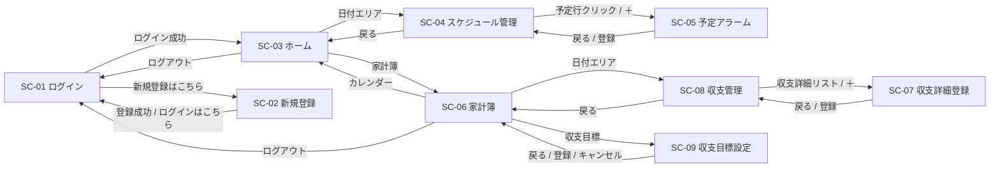

# やくそくんカレンダー 機能仕様（PD元資料 整理版）
やくそくんPD書

- 元資料：`PD元資料.xlsx` シート「機能一覧」（C2:L79 ＋ 貼付画像3点 ＋ テキストボックス3点）
- 整理方針：元資料の記述を画面単位・観点別に並べ替えたもの。内容の追加・推測による補完はしていない
- 凡例
  - `[E6]` … 出典セル（すべて「機能一覧」シート）。`[F28画像]` は該当位置に貼られた画像
  - ⚠ … 元資料内の矛盾・記載漏れ・要確認事項（末尾「要確認・矛盾一覧」に集約）
  - ※元資料に記載なし … 該当観点の記述が元資料に存在しない

---

## 1. 画面一覧

| ID | 画面名 | 概要 | レイアウト準拠HTML | 元資料の行範囲 |
|---|---|---|---|---|
| SC-01 | ログイン画面 | メールアドレス・パスワードで認証 | ログイン画面.html | 5〜9行 |
| SC-02 | 新規登録画面 | ユーザーアカウントの作成 | 新規登録画面.html | 10〜12行 |
| SC-03 | ホーム画面（カレンダー） | 月間カレンダーに天気・直近予定を表示、アラーム通知 | ホーム画面（カレンダー）.html | 13〜24行 |
| SC-04 | スケジュール管理画面 | 選択日の予定一覧・天気詳細・アラームON/OFF・削除 | スケジュール管理画面.html | 25〜33行 |
| SC-05 | 予定アラーム画面 | 予定の新規作成・更新 | 予定アラーム画面.html | 34〜41行 |
| SC-06 | 家計簿画面 | 月間カレンダーに日別収支、今月の収支状況、AIアドバイス | 家計簿画面.html | 42〜56行 |
| SC-07 | 収支詳細登録画面 | 収支の新規登録・更新 | 収支詳細登録画面.html | 57〜65行（＋E47） <!-- 2026/10/14 PD生成時に設計書修正が必要となったため --> |
| SC-08 | 収支管理画面 | 選択日の収支一覧・削除 | 収支管理画面.html | 66〜70行 |
| SC-09 | 収支目標設定画面 | 月別の収入金額・目標出費額の設定 | 収支目標設定画面.html | 71〜79行 |

## 2. 画面遷移



※SC-09の登録後の遷移先は元資料内で矛盾あり（⚠No.20）

---

## 3. 共通仕様

### 3.1 データベース接続 [E4]
- データベース名：`yakusokun`
- JDBC：PostgreSQL
- 接続情報はプロパティファイル `db.properties`（クラスパス直下＝`src/main/java` 直下に配置）を利用。JDBCドライバは Tomcat 共通 lib に格納済み（`WEB-INF/lib` への追加は不要） <!-- 2026/10/14 PD生成時に設計書修正が必要となったため -->
  ```
  db.url=jdbc:postgresql://localhost:5432/yakusokun
  db.user=postgres
  db.password=1234
  db.driver=org.postgresql.Driver
  ```

### 3.2 セッションスコープ一覧（元資料の記述から集約）

| キー | 内容 | 設定タイミング | 出典 |
|---|---|---|---|
| user | Userオブジェクト | ログイン成功時（必須） | [E6] |
| id | user.getId()（int/Integer） | ログイン成功時（必須） | [E6] |
| timestamp | 現在日時文字列 `yyyy-MM-dd HH:mm:ss` | ログイン成功時（必須。保存のみで、予定表示・アラーム検索の基準時刻には使用しない） | [E6] <!-- 2026/10/14 PD生成時に設計書修正が必要となったため --> |
| targetDay | 現在年月文字列 `yyyy-MM`。＜＞ボタンで±1か月 | ログイン成功時／ホーム・家計簿の＜＞ボタン | [E6][E24][E56][F42] |
| weather | 天気構造体×7日分 | ホーム画面表示時（未格納の場合のみAPI取得） | [E15] |
| scheduleDate | ホームのカレンダーで選択した日付（年月日） | ホームの日付エリア押下 | [E24][F28] |
| selectedWeather（例示名） | 選択日の天気構造体 | ホームの日付エリア押下 | [E24] |
| スケジュールid | 編集対象スケジュールのid（＋ボタンで削除） | スケジュール管理の予定行押下 | [E33] |
| 通知済みアラームID | alertのOK押下済みアラーム | alertのOK押下時 | [E23] |
| transactionDate | 家計簿のカレンダーで選択した日付（年月日） | 家計簿の日付エリア押下 | [E56][F56][F57][F59][F66] |
| update | 収支詳細の更新(true)／新規(false) | 収支詳細登録の初期表示時 | [E61][E62] |
| type_bk, date_bk, category_id_bk, amount_bk, memo_bk | 収支詳細の変更前の値 | 収支詳細登録の初期表示時 | [E60][E61][E62] |

### 3.3 テーブル・カラム（元資料の記述に現れたもの）

| テーブル | カラム | 出典 |
|---|---|---|
| users | id（自動採番, serial）, email（varchar(255)）, password_digest（SHA-256, varchar(255)）。email に一意制約はない | [E6][E11] <!-- 2026/10/14 PD生成時に設計書修正が必要となったため --> |
| schedules | id（serial）, user_id, title（varchar(10)）, category_id, day_time（date）, start_time（time）, end_time（time）, memo（varchar(30)）, has_alarm（既定false）, alarm_minutes_before, created_at（登録日時・既定CURRENT_TIMESTAMP・画面では扱わない） | [E20][E21][E32][E40] <!-- 2026/10/14 PD生成時に設計書修正が必要となったため --> |
| categories | id, name, color_code | [E13][F28画像] |
| transactions | id（収支履歴id, serial）, user_id, type（char(2)）, date（date）, category_id, amount（integer）, memo（varchar(50)）, created_at（画面では扱わない） | [E44][E47][E63] <!-- 2026/10/14 PD生成時に設計書修正が必要となったため --> |
| expense_categories | id, name, type, color_code | [F52画像][E57] |
| monthly_budgets | id（serial）, user_id, target_month（varchar(7)）, income_amount（既定0）, target_expense（既定0）。(user_id, target_month) に一意制約はない | [E51][E72][E76] <!-- 2026/10/14 PD生成時に設計書修正が必要となったため --> |

※テーブル名の表記ゆれあり（schedule／schedules、transaction／transactions）⚠No.1

### 3.4 マスタデータ（画像で貼付されていた表）

**categories（予定カテゴリ）** [F28画像][F36画像]

| id | name | color_code |
|---|---|---|
| 1 | 食事 | #FFADAD |
| 2 | 仕事 | #A0C4FF |
| 3 | 買い物 | #FDFFB6 |
| 4 | 遊び | #CAFFBF |
| 5 | 美容 | #FFC6FF |
| 6 | 病院 | #9BF6FF |
| 7 | デート | #FFD6A5 |
| 8 | その他 | #D9D9D9 |

**expense_categories（収支カテゴリ）** [F52画像][F61画像][F67画像]

| id | name | type | color_code |
|---|---|---|---|
| 1 | 収入 | 01（収入） | #A0C4FF |
| 10 | 食費 | 02（出費） | #FFADAD |
| 11 | 光熱費 | 02（出費） | #FDFFB6 |
| 12 | 雑費 | 02（出費） | #CAFFBF |

**収支区分 type**：01＝収入、02＝出費 [E44][F61]

### 3.5 天気コードとアイコン（別表１）[H16:L19][F15]
アイコン格納先：`src/main/webapp/images/weather` <!-- 2026/10/14 PD生成時に設計書修正が必要となったため -->

| 状態 | 天気コード | アイコン |
|---|---|---|
| 晴れ | 0, 1, 2, 3 | 晴れ.png |
| 雨 | 20, 21, 24, 25, 50～67, 80～84, 91, 92 | 雨.png |
| 雪 | 22, 23, 26, 36～39, 70～79, 85～88, 93, 94 | 雪.png |
| 雷 | 13, 17, 29, 89～100 | 雷.png |

⚠No.4：雷の「89～100」が雨の91・92、雪の93・94と重複。元資料では「WTO」と表記（WMOの誤記と思われる）

### 3.6 天気情報の取得（Open-Meteo API）[E15][F15]
- セッション `{weather}` を読み取り、情報がない場合のみAPIから取得し `{weather}` に格納（※ログイン中のみ更新）
- エンドポイント：`https://api.open-meteo.com/v1/forecast`
- クエリパラメータ

  | パラメータ | 値 | 意味 |
  |---|---|---|
  | latitude | 34.38628 | 緯度 |
  | longitude | 132.45503 | 経度 |
  | daily | weather_code, precipitation_probability_max, precipitation_sum, temperature_2m_max, temperature_2m_min | WMO天気コード、降水確率、日毎の降水量、最高気温、最低気温 |
  | timezone | Asia/Tokyo | JST |
  | forecast_days | 7 | 7日分（当日を含む7日間 [F13]） |

- 取得は日毎（daily）の情報で、日付のみ（時間要素を除く）＋最高・最低気温
- 格納形式：`[天気構造体[0] … 天気構造体[6]]`、天気構造体＝`[対象年月日, WMO天気コード, 降水確率, 日毎の降水量, 最高気温, 最低気温]`
- 拡張予定 [F15][F31]
  - 取得方法をバックグラウンド自動更新に変更
  - 位置情報をユーザー端末の位置データから取得する方式に変更

### 3.7 下部メニュー [E13④][E42⑦][E24][E56]
「カレンダー」「家計簿」「ログアウト」を左端から順に表示。表示中の画面に対応するボタンは非活性。

### 3.8 共通：未ログイン・例外・エラー表示
- 未ログイン：全画面で共通Filterが未ログイン（セッションに `id` なし）を検出し /login へリダイレクトする。除外：/login、新規登録、静的リソース（css・js・images）。AJAXリクエストは401を返し、JavaScriptでログイン画面へ遷移する
- 例外：DB例外・想定外エラーはサーブレットで捕捉・ログ出力し /WEB-INF/jsp/error.jsp へフォワードする（web.xml の error-page〔500・Throwable〕も同じ画面）。AJAXは500を返し、JavaScriptでalertを表示する。スタックトレースは画面に出さない
- 入力エラー：すべてJavaScriptのalertで表示する（画面内表示は行わない）
- 文字コード：UTF-8 <!-- 2026/10/14 PD生成時に設計書修正が必要となったため -->

---

## 4. 画面別仕様

### SC-01 ログイン画面

**4.1.1 画面表示項目**（上から表示順）[E5]

| No | 項目 | 内容 |
|---|---|---|
| ① | ヘッダー・ロゴ | 「やくそくんカレンダー」のロゴとキャラクター |
| ② | ログイン案内 | 画面タイトルと案内文「ようこそ！やくそくんカレンダーへ」「ログインして、あなたの予定と収支を管理しましょう」 <!-- 2026/10/14 PD生成時に設計書修正が必要となったため --> |
| ③ | ログイン情報入力 | メールアドレス、パスワード（入力内容は非表示） |
| ④ | ログイン操作 | 「ログイン」ボタン |
| ⑤ | 新規登録 | 「新規登録はこちら」ボタン |

**4.1.2 機能要件**

ログイン認証（③④）[E6]
1. 入力されたメールアドレス `{email}`・パスワード `{password}` を取得
2. usersテーブルに `{email}` と一致するメールアドレスが存在するか確認
3. 存在する場合、該当ユーザーの `{password_digest}` を取得
4. `{password}` をSHA-256でハッシュ化し、`{password_digest}`（SHA-256ハッシュ済み）と照合
5. 照合に問題がなければログインを許可
6. ログイン成功時、セッションに以下を保存（全件必須）
   - `user`：Userオブジェクト
   - `id`：user.getId()（int/Integer）
   - `timestamp`：現在日時 `yyyy-MM-dd HH:mm:ss`
   - `targetDay`：システム日付の年月 `yyyy-MM`

**4.1.3 入力チェック・エラー** [E6][E8]
- メールアドレスが存在しない、またはパスワードの照合に失敗した場合、エラーメッセージをalertで表示しログインを許可しない <!-- 2026/10/14 PD生成時に設計書修正が必要となったため -->
- エラーメッセージの文言：※元資料に記載なし

**4.1.4 画面遷移** [E7][E8][E9]

| 操作・条件 | 遷移先 |
|---|---|
| ログイン成功 | SC-03 ホーム画面（カレンダー） |
| ログイン失敗 | SC-01 ログイン画面（再表示） |
| 「新規登録はこちら」 | SC-02 新規登録画面 |

---

### SC-02 新規登録画面

**4.2.1 画面表示項目** [E10]

| No | 項目 | 内容 |
|---|---|---|
| ① | ヘッダー・ロゴ | 「やくそくんカレンダー」のロゴとキャラクター |
| ② | 新規登録案内 | 画面タイトルとアカウント作成を促す案内文（文言：※元資料に記載なし） |
| ③ | メールアドレス | 入力欄（必須表示） |
| ④ | パスワード | 入力欄（必須表示、入力内容は非表示） |
| ⑤ | パスワード確認 | 入力欄（必須表示、入力内容は非表示） |
| ⑥ | 登録操作 | 「登録する」ボタン |
| ⑦ | ログイン | 「ログインはこちら」とログイン画面へのリンク |

**4.2.2 機能要件**（新規ユーザー登録）[E11][E12]
1. メールアドレス `{email}`、パスワード `{password}`、パスワード（再確認用）を取得
2. 入力チェック（4.2.3）を実施
3. `{password}` をSHA-256でハッシュ化し `{password_digest}` を生成
4. `{password_digest}` と `{email}` をusersテーブルに登録
   - ユーザーID `{id}` は登録時に自動採番
   - `{password}` は一時的な値であり、DBには保存しない

**4.2.3 入力チェック・エラー** [E11]
- メールアドレスが入力されていること
- パスワード・パスワード（再確認用）が入力されていること
- パスワードとパスワード（再確認用）が一致していること
- usersテーブルに同じメールアドレスが存在しないこと
- メールアドレスの形式が正しいこと
- 問題がある場合：エラーメッセージをalertで表示し、新規登録画面のまま登録しない（文言：※元資料に記載なし） <!-- 2026/10/14 PD生成時に設計書修正が必要となったため -->

**4.2.4 画面遷移** [E11][E12]

| 操作・条件 | 遷移先 |
|---|---|
| 「登録する」→ 登録成功 | SC-01 ログイン画面 |
| 「登録する」→ 入力エラー | SC-02（再表示） |
| 「ログインはこちら」 | SC-01 ログイン画面 |

---

### SC-03 ホーム画面（カレンダー）

**4.3.1 画面表示項目** [E13]

| No | 項目 | 内容 | HTMLクラス |
|---|---|---|---|
| ⓪ | （初期処理） | セッション `{targetDay}` を年月表示欄に設定 | ― |
| ① | 年月表示 | 表示中の年月（例：2026年8月）をヘッダー中央に表示。左右に＜／＞ボタン | current-month |
| ② | 曜日表示 | 日曜〜土曜 | ― |
| ③ | カレンダー | 月間ブロック式。表示年月と一致しない日付マスはグレーでハッチング | ― |
| ③-1 | 天気（日付マス内） | 天気アイコン（条件該当時のみ）※4.3.2 | weather-icon |
| ③-2 | 降水確率（日付マス内） | 青色テキストで「％」付き（例：【50%】）、天気アイコンの右（日付マス上部の日付と同じ行の右側） | weather-pop <!-- 2026/10/14 PD生成時に設計書修正が必要となったため --> |
| ③-3 | 予定の開始時刻（日付マス内） | 開始日時 `{start_time}` の時分 ※4.3.3 | schedule-time |
| ③-4 | 予定のカテゴリ（日付マス内） | カテゴリ名 `{name}`、カテゴリカラー `{color_code}` で色付け | schedule-label |
| ④ | 下部メニュー | カレンダー（非活性）／家計簿／ログアウト | ― |
| ⑤ | （アラーム） | アラームセット機能の実施 ※4.3.4 | ― |

**4.3.2 機能要件：天気情報表示**（③、ログイン中のみ更新）[E15][F13]
- 取得：3.6のとおり
- 表示：日付マスの件数分ループし、各マスで `{weather}` の7件をループ
  - `天気構造体[i].対象年月日` が日付マスの年月日と一致する場合、天気コードから晴れ／雨／雪／雷を判定し、3.5の表に従ってアイコンを表示
  - 降水確率を青色テキスト「【50%】」形式でアイコンの下に表示
- 対象日：当日を含む7日間

**4.3.3 機能要件：予定表示**（③）[E20][E13]
- セッションから `{id}` を取得し、schedulesテーブルから該当月の全予定を抽出
- 表示対象月の日数分ループし、日付マスごとに以下の条件で抽出
  ```
  user_id = セッション{id}
  AND day_time の日付部分 = 日付マスの年月日
  AND ( day_time > 今日の日付
        OR ( day_time = 今日の日付 AND start_time > 現在時刻（処理時点の時刻部分） ) )
  ```
  （今日・現在時刻は処理時点のシステム日時。`start_time` は時刻型） <!-- 2026/10/14 PD生成時に設計書修正が必要となったため -->
- 抽出した中で開始時刻が最も早い1件（MIN(start_time)）のみ表示
- 抽出できた場合：`category_id` でcategoriesテーブルから `{name}`・`{color_code}` を取得し、カテゴリ名を表示、その下に開始時刻（時分）を表示、予定をカテゴリカラーで色付け
- 該当予定がない場合：日付マスに何も表示しない

**4.3.4 機能要件：アラームセット・通知**（⑤）[E21][E22][E23]

(a) アラーム情報取得（サーバー側）
- セッションから `{id}` を取得し、処理時点の現在日時を基準に、schedulesテーブルを以下の条件で検索 <!-- 2026/10/14 PD生成時に設計書修正が必要となったため -->
  - `user_id = {id}`
  - `day_time` と `start_time` を合わせた日時が現在日時以降（`>=`）のうち、最小のもの <!-- 2026/10/14 PD生成時に設計書修正が必要となったため -->
  - `has_alarm = true`
- 該当あり：リクエストスコープに `title`, `start_time`, `end_time`, `alarm_minutes_before`, `memo` を設定
- 該当なし：リクエストスコープから上記5項目を削除

(b) JSPに組み込むJavaScript
- リクエストスコープに上記オブジェクトが存在する場合
  - アラーム通知時刻 ＝（`day_time` の日付 ＋ `start_time`）−（`alarm_minutes_before` 分） <!-- 2026/10/14 PD生成時に設計書修正が必要となったため -->
  - タイマーで通知時刻まで待機
  - 通知時刻を経過し、かつ `start_time` を超過していない場合、alertで `title`, `start_time`, `end_time`, `memo` を表示
  - 上記以外の場合はalertを表示しない

(c) 通知は一度限り
- alertの「OK」押下後は同じアラームを再通知しない
- `alarm_minutes_before` は変更せず、「通知済み」をセッションスコープで管理
- アラームを一意に識別できるID単位で管理し、他のアラームには影響させない
- OK押下後、JavaScriptからServlet等を呼び出し、セッションに対象アラームIDを通知済みとして登録
- JSP再表示時、通知済みIDのアラームはタイマー設定もalert表示もしない
- 画面が遷移した場合はアラームを停止

**4.3.5 入力チェック・エラー**：※元資料に記載なし

**4.3.6 画面遷移** [E24]

| 操作 | 処理・遷移先 |
|---|---|
| カレンダーボタン | 非活性 |
| 家計簿ボタン | SC-06 家計簿画面 |
| ログアウトボタン | SC-01 ログイン画面 |
| ＜ボタン | `{targetDay}` を表示年月−1か月に設定し、SC-03を再読み込み |
| ＞ボタン | `{targetDay}` を表示年月＋1か月に設定し、SC-03を再読み込み |
| カレンダーの日付エリア | 選択日を `{scheduleDate}` としてセッションに設定。該当日の天気構造体をセッション（例：`{selectedWeather}`）に保持し、SC-04 スケジュール管理画面へ |

---

### SC-04 スケジュール管理画面

**4.4.1 画面表示項目** [E25][E26][E28]
- レイアウトは「スケジュール管理画面.html」に準拠

| 項目 | 内容 | HTMLクラス |
|---|---|---|
| 年月日表示（ヘッダー中央） | `{scheduleDate}` を `yyyy年 M月d日 (曜日)` で表示（例：2026年 8月10日 (月)。年の後に半角空白、曜日は半角括弧） | date-title <!-- 2026/10/14 PD生成時に設計書修正が必要となったため --> |
| 天気詳細（画面上部） | 4.4.3参照 | ― |
| 予定一覧（各行） | 下表 | schedule-row |
| ＋ボタン | 位置はHTMLに準拠 | ― |
| 戻るボタン | ※表示仕様は元資料に記載なし（遷移のみ記載 [E33]） | ― |

予定一覧の各行 [E28]

| 項目 | 内容 | HTMLクラス |
|---|---|---|
| スケジュールid | 非表示項目として `{id}` を保持 | ― |
| 時刻 | `{start_time}` の時刻（例：08:00。HH:mm、ゼロ埋め） | time <!-- 2026/10/14 PD生成時に設計書修正が必要となったため --> |
| タイトル | `{title}` | schedule-name |
| 時間帯 | `{start_time}`〜`{end_time}`（例：19:00 - 21:00） | schedule-time |
| カテゴリ | `category_id` でcategoriesテーブルから `{name}` を取得。文字色・背景色・左ボーダー色は html の CSS クラス `category-NN`（NN＝category_id の2桁）で指定する（ホーム画面のみ `{color_code}` をインライン指定） | category-name <!-- 2026/10/14 PD生成時に設計書修正が必要となったため --> |
| アラームスイッチ | 行の右端にON/OFFスイッチ。schedulesの `{has_alarm}` を表示 | switch |
| 「・・・」ボタン | スケジュール削除ボタン。行の右端（html の schedule-right） | schedule-right <!-- 2026/10/14 PD生成時に設計書修正が必要となったため --> |

**4.4.2 機能要件：スケジュール詳細表示** [E28][E26]
1. セッション `{scheduleDate}` を取得し、年月日表示欄に設定
2. セッション `{id}` と `user_id` を照合し、`{scheduleDate}` と `{day_time}` が一致するスケジュールを全件抽出
3. `{start_time}` の順に一覧表示（元資料の表記は「昇降順」⚠No.7）

**4.4.3 機能要件：天気詳細表示**（※ログイン中のみ更新）[E31][F31]
- セッション `{weather}` に情報がある場合、画面上部に以下を表示
  - 天候名と天気イラスト（`images/weather/` から取得）
  - 晴れ・雨・雪・雷以外はデフォルト画像 `予報なし.png`（images/weather 内）を表示 <!-- 2026/10/14 PD生成時に設計書修正が必要となったため -->
  - 該当日の最高気温、最低気温、降水確率
- `{weather}` に情報がない場合：天気表示欄に「予報対象外」と表示し、アイコン・気温・降水確率は非表示

**4.4.4 機能要件：アラームON/OFF** [E32][E26]
- 表示：対象スケジュールの `{has_alarm}` と `{alarm_minutes_before}` を取得し、switchにON(true)／OFF(false)を表示。新規予定は既定値falseによりOFF
- 操作時の更新
  - スケジュールの `{id}` とログインユーザーの `{user_id}` の両方で対象を特定（他ユーザーの予定を更新しないため）
  - OFF→ON：`{alarm_minutes_before}` が未設定なら15分前を設定
  - ON→OFF：`{has_alarm}` のみOFFにし、`{alarm_minutes_before}` は保持
  - 再度OFF→ON：保持している `{alarm_minutes_before}` を使用
- 反映：更新成功後、switchに最新状態を反映。再表示時もDBの最新値を表示
- ONの予定はホーム画面でalert通知される（4.3.4）

**4.4.5 機能要件：スケジュール削除** [E30][E26]
1. 「・・・」ボタン押下で、`user_id` を照合し該当日 `{day_time}` の該当スケジュール `{id}` を特定
2. 確認ダイアログ「予定を削除してよろしいですか？」（YES/NO）を表示
   - YES：schedulesテーブルから該当 `{id}` を削除
   - NO：データを変更せず、スケジュール管理画面のまま

**4.4.6 入力チェック・エラー**：※元資料に記載なし

**4.4.7 画面遷移** [E33]

| 操作 | 処理・遷移先 |
|---|---|
| 戻るボタン | SC-03 ホーム画面 |
| 予定行（schedule-row）クリック | 非表示の `{id}` をセッション `{スケジュールid}` に設定し、SC-05（予定アラーム初期画面表示）へ |
| ＋ボタン | セッション `{スケジュールid}` を削除し、SC-05（予定アラーム初期画面表示）へ |

---

### SC-05 予定アラーム画面

**4.5.1 画面表示項目**（入力フォーム、上から表示順）[E34][F35][E36]
- レイアウトは「予定アラーム画面.html」に準拠

| 項目 | 内容 | 対応カラム |
|---|---|---|
| 日付 | `{scheduleDate}` を `yyyy/MM/dd`（例：2026/08/26。月日ゼロ埋め）で表示 | day_time <!-- 2026/10/14 PD生成時に設計書修正が必要となったため --> |
| タイトル | 入力 | title |
| カテゴリー | categoriesテーブルのカテゴリ名一覧から選択（3.4参照） | category_id |
| 時間設定 | 開始時間・終了時間を入力／選択 | start_time, end_time |
| 内容 | 予定の詳細を入力 | memo |
| アラーム | 通知時間を選択：1時間前／30分前／15分前／なし（セレクトボックス。初期値は「なし」） | has_alarm, alarm_minutes_before <!-- 2026/10/14 PD生成時に設計書修正が必要となったため --> |
| 戻る・登録ボタン | 4.5.4参照 | ― |

**4.5.2 機能要件：初期表示** [E35][E36]
- セッション `{スケジュールid}` が存在する場合（更新）
  - schedulesテーブルから `id = {スケジュールid}` のレコードを抽出し、フォームに初期値を設定：日付 `{day_time}`、タイトル `{title}`、カテゴリ（`category_id` → categoriesの `{name}`）、開始時間 `{start_time}`、終了時間 `{end_time}`、内容 `{memo}`、アラーム `{alarm_minutes_before}`
- 存在しない場合（新規）
  - `{scheduleDate}` を日付欄に設定（`yyyy/MM/dd`）、それ以外の項目は初期化

**4.5.3 機能要件：登録（FORM実行）** [E37][E39][E40]
1. 入力チェック（4.5.4）を実行
2. 問題なければスケジュールテーブル更新処理を実施し、SC-04へ遷移。問題があればSC-05を再表示
3. スケジュールテーブル更新処理
   - `{スケジュールid}` あり：`id = {スケジュールid}` のレコードを更新
   - なし：レコードを追加
4. 設定値

   | カラム | 設定値 |
   |---|---|
   | user_id | セッションの `{id}` |
   | day_time | `{scheduleDate}` |
   | title | 入力したタイトル |
   | category_id | 選択したカテゴリの `{id}` |
   | start_time | 時間設定.開始時間 |
   | end_time | 時間設定.終了時間 |
   | memo | 入力した内容（未入力はNULL） |
   | has_alarm | アラームが「なし」以外なら true、「なし」なら false <!-- 2026/10/14 PD生成時に設計書修正が必要となったため --> |
   | alarm_minutes_before | 「なし」以外：選択した値（15/30/60）／「なし」：NULL <!-- 2026/10/14 PD生成時に設計書修正が必要となったため --> |

**4.5.4 入力チェック・エラー** [E38]
- 日付、タイトル、カテゴリ、開始時間、終了時間が入力されていること
- 開始時間が終了時間より前であること
- タイトルは10文字以内、内容 `{memo}` は30文字以内であること。エラーはalertで表示する <!-- 2026/10/14 PD生成時に設計書修正が必要となったため -->
- 内容 `{memo}` は未入力ならNULLで登録
- エラーメッセージの文言・表示位置：※元資料に記載なし

**4.5.5 戻るボタンの動作** [E36]
- フォームの入力内容と、DBから取得した変更前の登録内容を比較
  - 変更あり：確認ダイアログ「予定の変更を破棄してもよろしいですか」（YES/NO）
    - YES：変更を破棄し、DBを更新せずSC-04へ
    - NO：入力内容を保持したままSC-05を維持
  - 変更なし：確認ダイアログを表示せず、スケジュール管理（画面へ遷移）⚠No.9（記述が途中で途切れている）
- 新規作成時の戻るボタンの比較方法：※元資料に記載なし

**4.5.6 画面遷移** [E41]

| 操作 | 遷移先 |
|---|---|
| 戻るボタン | SC-04 スケジュール管理画面（4.5.5の確認あり） |
| 登録ボタン（成功時） | SC-04 スケジュール管理画面 |

---

### SC-06 家計簿画面

**4.6.1 画面表示項目** [E42]
- レイアウトは「家計簿画面.html」に準拠
- 番号は元資料のまま（②⑥は欠番）

| No | 項目 | 内容 | HTMLクラス |
|---|---|---|---|
| ⓪ | （初期処理） | セッション `{id}` で該当月のtransactionsを全件抽出。`{targetDay}` を年月表示欄に設定 | ― |
| ① | 年月表示 | `yyyy年M月`（例：2026年9月。月ゼロ埋めなし）をヘッダー中央に表示 | current-month <!-- 2026/10/14 PD生成時に設計書修正が必要となったため --> |
| ① | ＜ボタン | | nav-btn nav-prev |
| ① | ＞ボタン | | nav-btn nav-next |
| ① | 収支目標ボタン | ［収支目標］ボタン | target-btn |
| ③ | カレンダー | 月間ブロック式。収支登録がある日付マスに日別収支額を表示 ※4.6.2 | ― |
| ④ | 今月の収支状況 | 収入予定額、目標支出額、今月の合計出費、現在の支出残額、目標到達率（5項目。カレンダーの下）※4.6.3 | ― <!-- 2026/10/14 PD生成時に設計書修正が必要となったため --> |
| ⑤ | AIによる今週のアドバイス | 支出状況をもとにしたアドバイス ※4.6.4 | ― |
| ⑦ | 下部メニュー | カレンダー／家計簿（非活性）／ログアウト | ― |

**4.6.2 機能要件：収支額表示**（③）[E44]
- セッション `{id}` で該当月のtransactionsを全件抽出
- 対象月の日数分ループし、日付マスごとに以下の条件で抽出
  ```
  user_id = セッション{id}
  AND date の日付部分 = 日付マスの年月日
  AND type IN ('01'：収入, '02'：出費)
  ```
- 日別収支額 `{daily_balance}` ＝ 収入金額の合計 − 出費金額の合計
- 表示ルール

  | 条件 | 表示 |
  |---|---|
  | 該当日に収支データなし | 何も表示しない |
  | daily_balance ＜ 0 | 「－￥金額」赤色（html の `balance-negative`。`balance-tag` 内に表示） |
  | daily_balance ＞ 0 | 「＋￥金額」青色（`balance-positive`） |
  | データあり かつ daily_balance ＝ 0 | 「￥0」（`balance-zero`：#333） <!-- 2026/10/14 PD生成時に設計書修正が必要となったため --> |

- 常にtransactionsテーブルの最新情報で算出

**4.6.3 機能要件：今月の収支状況（出費目標額表示）**（④）[E46][E51]
1. セッションから `{id}` と `{targetDay}` を取得（`{id}`→user_id、`{targetDay}`→transactions.dateの年月、monthly_budgets.target_month の照合に使用）
2. 目標出費額：monthly_budgetsから `user_id={id} AND target_month={targetDay}` で抽出し、`{target_expense}` を取得・表示
3. 出費合計：transactionsから `user_id={id} AND dateの年月={targetDay} AND type='02'` で抽出し、`{amount}` と `{category_id}` を取得
   - 出費金額合計 `{total_expense}` ＝ `{amount}` の合計
4. 出費目標額残高 `{remaining_expense}` ＝ `{target_expense}` − `{total_expense}`
5. カテゴリ別出費：`category_id` でexpense_categoriesから `{name}` を取得し、カテゴリ別に合計して `{category_expense}` を算出
6. 目標到達比率 `{achievement_rate}` ＝ `{total_expense}` ÷ `{target_expense}` × 100
7. カレンダーの下に表示
   - 収入予定額:`{income_amount}`（monthly_budgets）
   - 目標支出額:`{target_expense}`
   - 今月の合計出費:`{total_expense}`
   - 現在の支出残額:`{remaining_expense}`
   - 目標到達率:`{achievement_rate}`（金額は桁区切りなし。例：￥200000） <!-- 2026/10/14 PD生成時に設計書修正が必要となったため -->
- 補足
  - 上記の算出値はDBに専用テーブル・カラムを持たず、画面表示時にリアルタイムで算出
  - 取得した `{target_expense}`、`{amount}`、`{category_id}`、算出した `{total_expense}` は同一画面の後続処理（AIアドバイス）で再利用
- `{target_expense}` が0または未登録の場合の扱い：※元資料に記載なし

**4.6.4 機能要件：AIアドバイス（支出管理機能）**（⑤）[E54]
- AIモデル：Gemini（gemini-3.6-flash）
- APIキー：環境変数 `GEMINI_API_KEY`
- 処理
  1. セッション `{id}` でtransactions・monthly_budgetsの `user_id` を照合
  2. monthly_budgetsから該当月の `{target_expense}` を取得
  3. transactionsから該当月・`type='02'` の `{amount}` を取得し、カテゴリ別に合計して `{category_expense}` を算出
  4. カテゴリ別比率 ＝ `{category_expense}` ÷ `{target_expense}` × 100
  5. 目標出費額・出費金額・カテゴリ別支出割合をGemini APIへ送信
  6. 生成された分析結果・アドバイスを画面にテキスト形式で表示
- プロンプト内容、API失敗時の表示：※元資料に記載なし

**4.6.5 入力チェック・エラー**：※元資料に記載なし

**4.6.6 画面遷移** [E56]

| 操作 | 処理・遷移先 |
|---|---|
| ＜ボタン | `{targetDay}` を−1か月に設定し、SC-06を再読み込み |
| ＞ボタン | `{targetDay}` を＋1か月に設定し、SC-06を再読み込み |
| カレンダーの日付エリア | 選択日を `{transactionDate}` としてセッションに設定し、SC-08 収支管理画面へ |
| 収支目標ボタン | SC-09（初期画面表示 → 新規／更新判定 → 更新時は既存データ表示） |
| カレンダーボタン | SC-03 ホーム画面 |
| 家計簿ボタン | 非活性 |
| ログアウトボタン | SC-01 ログイン画面 |

---

### SC-07 収支詳細登録画面

※元資料では、この画面の処理が2か所に分かれて記載されている（家計簿画面ブロック内の[E47]と、本画面ブロックの[E57]〜[E65]）。⚠No.12

**4.7.1 画面表示項目** [E57][F61]
- レイアウトは「収支詳細登録.html」に準拠 [E59]

| No | 項目 | 内容 | HTMLクラス |
|---|---|---|---|
| ① | ＜（戻る）ボタン | ヘッダー | back-btn |
| ① | 画面タイトル | 「収支詳細登録」 | title |
| ② | 日付 | `{transactionDate}` を `yyyy/MM/dd`（例：2026/08/10。月日ゼロ埋め）で表示 | input-control <!-- 2026/10/14 PD生成時に設計書修正が必要となったため --> |
| ② | タイプ | 収支区分を選択（選択肢の並びは 出費、収入の順）：01：収入／02：出費。新規時の初期選択は 01（収入）。金額欄は「¥1,200」形式で表示 | type（class="input-control"） <!-- 2026/10/14 PD生成時に設計書修正が必要となったため --> |
| ② | カテゴリー | expense_categoriesから選択。収支カラー `{color_code}` とカテゴリ名 `{name}` を表示 | color-badge |
| ② | 金額 | 収支金額を入力 | ― |
| ② | メモ | 収支に関する内容を入力（未入力はNULL） | ― |
| ③ | 登録ボタン | | ― |

**4.7.2 機能要件：初期表示（サーブレット）** [E59][E61][E62][E47]
1. セッション `{id}` を取り込む
2. 新規／更新の判定
   - [E59]：transactionsにセッション `{id}` と一致する `user_id` のデータが存在すれば更新、なければ新規
   - [E47]：`user_id={id}` かつ `収支履歴id={transactions.id}` で抽出し、存在すれば更新、なければ新規
   - ⚠No.13：判定条件が2か所で異なる
3. 更新の場合 [E61][E47]
   - 既存データの `{type}`, `{date}`, `{category_id}`（→ `{name}`）, `{amount}`, `{memo}` を各入力欄の初期値に設定
   - セッション `{update}=true`
   - 初期値をセッション `{type_bk}`, `{date_bk}`, `{category_id_bk}`, `{amount_bk}`, `{memo_bk}` に退避
4. 新規の場合 [E62]
   - 初期値：日付＝`{transactionDate}`、タイプ＝01（収入）、カテゴリー＝収入、金額＝0、メモ＝null
   - セッション `{update}=false`
   - 初期値を `_bk` 系セッションに退避
5. カテゴリ選択肢の制御（JavaScript）
   - `type=01` → `category_id=1(01)` のみ
   - `type=02` → `category_id=10, 11, 12` のみ
6. ボタン機能を組み込んだJSPを表示

**4.7.3 機能要件：登録（サーブレット）** [E63][E64][E47]
1. 画面から `{type}`, `{date}`, `{category_id}`, `{amount}`, `{memo}` を取得
2. 入力チェック（4.7.4）
3. transactionsテーブル更新
   - `{update}=true`：`id`（収支履歴id）が一致するレコードを更新
   - `{update}=false`：レコードを追加
   - 設定値 [E47]

     | カラム | 設定値 |
     |---|---|
     | user_id | セッションの `{id}` |
     | type | 選択した収支区分 |
     | date | 入力した日付 |
     | category_id | 選択した収支カテゴリの `{id}` |
     | amount | 入力した金額 |
     | memo | 入力したメモ（未入力はNULL） |

   - ⚠No.14：[E64]には「更新対象データは `_bk` 系セッションから設定」とあり、入力値で更新する[E47]と矛盾
4. 成功時はSC-08 収支管理画面へ

**4.7.4 入力チェック・エラー** [E63][E47]
- 必須：`{type}`, `{date}`, `{category_id}`, `{amount}`
- `{type}` は01（収入）または02（出費）
- `{category_id}` は選択した収支区分に対応するカテゴリであること
- `{memo}` は未入力ならNULL
- エラー時：エラーメッセージをalertで表示し、SC-07に留まる（文言：※元資料に記載なし）。メモは50文字以内であること <!-- 2026/10/14 PD生成時に設計書修正が必要となったため -->

**4.7.5 戻るボタンの動作（JavaScript）** [E60]
- 入力値と `_bk` 系セッションの値を比較
  - 変更あり：確認ダイアログ「収支詳細内容の変更を破棄してもよろしいですか」（YES/NO）
    - YES：変更を破棄し、DBを更新せずSC-08へ
    - NO：変更を保持したままSC-07を維持
  - 変更なし：ダイアログなしでSC-08へ

**4.7.6 画面遷移** [E65][E47][E59]

| 操作 | 遷移先 |
|---|---|
| 戻るボタン | SC-08 収支管理画面（4.7.5の確認あり） |
| 登録ボタン（成功時） | SC-08 収支管理画面 |
| 登録ボタン（エラー時） | SC-07（再表示） |

---

### SC-08 収支管理画面

**4.8.1 画面表示項目** [E66][E67]
- レイアウトは「収支管理画面.html」に準拠 [E67]

| No | 項目 | 内容 |
|---|---|---|
| ⓪ | （初期処理） | セッション `{transactionDate}` を取り込み、年月日表示欄に設定 |
| ① | 日付（ヘッダー中央） | `yyyy年 M月d日`（例：2026年 8月10日。年の後に半角空白、月日ゼロ埋めなし） <!-- 2026/10/14 PD生成時に設計書修正が必要となったため --> |
| ① | ＜（戻る）ボタン | 左端 |
| ② | 収支一覧（各行） | 内容（メモ）、金額、収支カテゴリ、削除ボタン |
| ③ | ＋（追加）ボタン | 右端 |

**4.8.2 機能要件：収支一覧表示** [E67]
- transactionsから `user_id={id} AND date={transactionDate}` で抽出し、`{memo}`, `{category_id}`, `{amount}`, `{type}` を取得
- メモ：`{memo}` を表示（NULLは空白）
- カテゴリ：`{category_id}` で expense_categories テーブルと照合し、収支カテゴリ名とカラーコードを表示（01：収入／10：食費、11：光熱費、12：雑費）。行の見た目クラスは id 1→income、10→food、11→utility、12→misc <!-- 2026/10/14 PD生成時に設計書修正が必要となったため -->
- 金額：収支履歴idごとに表示
  - `type=01`（収入）：「￥30,000」形式（3桁カンマ区切り）
  - `type=02`（出費）：「-￥4,550」形式（半角ハイフン、3桁カンマ区切り） <!-- 2026/10/14 PD生成時に設計書修正が必要となったため -->
- データがない場合：一覧に何も表示しない
- 追加・削除・修正があった場合はtransactionsを再取得して一覧を更新

**4.8.3 機能要件：収支削除** [E69]
1. セッション `{id}` でusersの `user_id` を照合
2. 削除対象の収支 `{id}` をtransactionsから取得
3. 「・・・」ボタン押下で、確認ダイアログ「収支情報を削除してよろしいですか？」（YES/NO）を表示
   - YES：transactionsから該当 `{id}` を削除
   - NO：データを変更せず、収支管理画面のまま
- ⚠No.17：画面表示では「削除ボタン」、機能では「・・・」ボタンと表記が異なる

**4.8.4 入力チェック・エラー**：※元資料に記載なし

**4.8.5 画面遷移** [E70]

| 操作 | 遷移先 |
|---|---|
| 戻るボタン | SC-06 家計簿画面 |
| 収支詳細リスト（行）クリック | SC-07（初期画面表示 → 新規／更新判定 → 既存データ表示） |
| ＋ボタン | SC-07（初期画面表示 → 新規／更新判定 → 新規作成） |

- 行クリック時に対象の収支idを受け渡す方法：※元資料に記載なし（⚠No.13と関連）

---

### SC-09 収支目標設定画面

**4.9.1 画面表示項目** [E71][E72]
- レイアウトは「収支目標設定画面.html」に準拠 [E72]

| No | 項目 | 内容 |
|---|---|---|
| ⓪ | （初期処理） | セッション `{targetDay}` を年月表示欄に設定 |
| ① | ヘッダー | `yyyy年M月` ＋ 半角空白 ＋ 「収支目標設定」（例：2026年8月 収支目標設定。月ゼロ埋めなし） <!-- 2026/10/14 PD生成時に設計書修正が必要となったため --> |
| ② | 収入設定 | 収入金額の入力欄（「￥」は付けない） |
| ③ | 目標支出額設定 | 目標支出額の入力欄（「￥」は付けない） <!-- 2026/10/14 PD生成時に設計書修正が必要となったため --> |
| ④ | 登録ボタン | |
| ― | 戻るボタン | 遷移は記載あり[E79]。キャンセルボタンは設けない（html になし） <!-- 2026/10/14 PD生成時に設計書修正が必要となったため --> |

**4.9.2 機能要件：初期表示** [E72]
- セッション `{id}`, `{targetDay}` で monthly_budgets を `user_id={id} AND target_month={targetDay}` で検索
- データあり（更新）：`{income_amount}`, `{target_expense}` を初期値として表示
- データなし：
  - 前月（`{targetDay}`−1か月）のデータを検索し、あれば前月の `{income_amount}`, `{target_expense}` を初期値として表示
  - 前月もない場合（新規）：収入金額0、目標出費額0
- ⚠No.19：前月データの引き継ぎが「更新設定処理」の中に書かれており、新規処理との分岐関係が不明確

**4.9.3 機能要件：登録（FORM実行）** [E72][E76]
1. 入力チェック（4.9.4）
2. 問題なければmonthly_budgetsテーブルを登録・更新
   - 設定値：`user_id`＝セッション `{id}`、`target_month`＝セッションの対象年月、`income_amount`＝入力値（空はゼロ）、`target_expense`＝入力値（空はゼロ）
   - 追加と更新の判定条件：※元資料に記載なし
3. 問題があれば収支目標設定画面のまま

**4.9.4 入力チェック・エラー** [E76]
- 対象年月 `{target_month}` が設定されていること
- 収入金額・目標出費額が数値として入力されていること
- 未入力・空白（null）は数値の0として扱う
- エラーメッセージはalertで表示する（文言：※元資料に記載なし） <!-- 2026/10/14 PD生成時に設計書修正が必要となったため -->

**4.9.5 キャンセルの動作** [E78][E79]
- キャンセルボタンは設けないため本節の動作は不要（戻るボタンは確認なしで SC-06 へ遷移） <!-- 2026/10/14 PD生成時に設計書修正が必要となったため -->

**4.9.6 画面遷移** [E79][E72]

| 操作 | 遷移先 |
|---|---|
| 戻るボタン | SC-06 家計簿画面 |
| 登録ボタン（成功時） | SC-06 家計簿画面 <!-- 2026/10/14 PD生成時に設計書修正が必要となったため --> |
| 登録ボタン（エラー時） | SC-09（遷移しない） <!-- 2026/10/14 PD生成時に設計書修正が必要となったため --> |

---

## 5. 要確認・矛盾一覧

| No | 画面 | 内容 | 出典 |
|---|---|---|---|
| 1 | 共通 | テーブル名の表記ゆれ：schedule／schedules、transaction／transactions | [E13][E20][E42][E44] |
| 2 | 共通 | 「家計簿画面」と「家計簿表画面」の表記ゆれ | [E79] |
| 3 | SC-03 | 天気コードが「WTO」と表記（WMOの誤記と思われる）。「軽度」は「経度」の誤記と思われる | [E15][H16] |
| 4 | SC-03 | 天気コードの重複：雷「89～100」が雨の91・92、雪の93・94と重なる | [I18:L18] |
| 5 | SC-03 | 予定表示で「day_time > 今日」と「start_time > timestamp」の比較に日付と日時が混在。アラームセットは `start_time >= timestamp` で、予定表示と条件が異なる | [E20][E21] |
| 6 | SC-03→04 | 選択日の天気構造体を `{selectedWeather}` に保持するとあるが、SC-04の天気詳細は `{weather}` を参照。保持項目も「最高気温・最低気温・降水量・気温」と表示項目（降水確率）が異なる | [E24][E31] |
| 7 | SC-04 | 予定一覧の並び順が「昇降順」と記載（昇順か降順か不明） | [E28] |
| 8 | SC-04 | 「・・・」ボタンの位置が「左端」と記載されているが、クラス名は schedule-right | [E28] |
| 9 | SC-05 | 戻るボタン【変更なし】の記述が「スケジュール管理」で途切れている | [E36] |
| 10 | SC-05/07 | 日付形式 `yyyy/MM/dd` の例が「2026/8/26」「2026/8/10」（MMなら08） | [F35][F61] |
| 11 | SC-04 | 処理制御機能で「・・・」ボタンの記述が重複している | [E26] |
| 12 | SC-06/07 | 収支詳細登録画面の処理が家計簿画面ブロック（出費目標額表示機能の下）に記載されている | [E47] |
| 13 | SC-07 | 新規／更新の判定条件が2か所で異なる（user_idのみ／user_id＋収支履歴id）。user_idのみの場合、既存データのあるユーザーは常に更新になる | [E47][E59] |
| 14 | SC-07 | 更新時のデータを `_bk`（変更前の値）から設定するとあり、入力値で更新する記述と矛盾 | [E64][E47] |
| 15 | SC-07 | 既存更新の金額が `{amkount}` と誤記。カテゴリが「カテゴリテーブル」と記載 | [E61] |
| 16 | SC-08 | 収支カテゴリの参照先が categories テーブルと記載（expense_categoriesの誤りと思われる） | [E67] |
| 17 | SC-08 | 削除ボタンの表記が「削除ボタン」と「・・・ボタン」で異なる | [E66][E69] |
| 18 | SC-06 | 画面表示詳細の番号が②⑥欠番。出費目標額表示機能（D46）に処理名のない記述（E51）が続く | [E42][E46][E51] |
| 19 | SC-09 | 前月データの引き継ぎが更新処理の中に記載されており、新規処理（0初期化）との使い分けが不明確 | [E72] |
| 20 | SC-09 | 登録後の遷移先が「収支目標設定画面」と「家計簿表画面」で矛盾 | [E72][E79] |
| 21 | SC-09 | キャンセル確認を常に出すか、変更時のみ出すかが矛盾。ボタン名もYES/NOとOK/キャンセルで異なる。画面表示項目にキャンセル・戻るボタンの記載なし | [E78][E79][E71] |
| 22 | SC-09 | 登録処理名が「monthly_budgetsテーブル更新処理」と「収支目標設定登録設定処理」で一致しない | [E72][E76] |
| 23 | 全画面 | エラーメッセージの具体的な文言・表示位置がほぼ未記載 | ― |

## 6. 付録：元資料のレビューコメント（テキストボックス）

元資料に貼られていたテキストボックスの内容です。仕様ではなく、レビュー時の指摘と思われるため本文には含めていません。

| 位置 | 内容 |
|---|---|
| E25付近（SC-04） | 詳細内容を定義しないのであれば説明を割愛するか、どこで説明しているかを明示する。不確かな説明文から、AIがデータではなく文字列を生成してしまう |
| E33付近（SC-04） | 予定が表示される時間の範囲を決定する。→ 範囲はどこで使っているのか |
| E33付近（SC-04） | 表示するデータをどこに設定するのか指定する → HTMLの定義箇所クラス名を使う |
